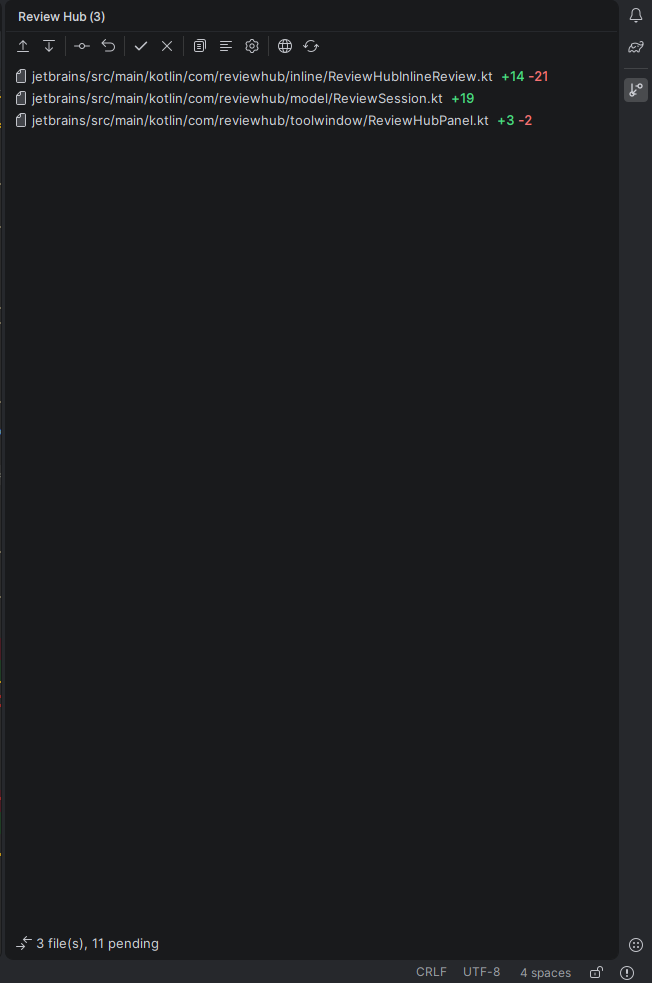
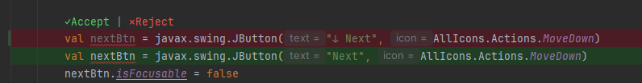

# Review Hub for JetBrains IDEs

The official Review Hub plugin for IntelliJ IDEA, WebStorm, PyCharm, CLion, GoLand, Android Studio, PhpStorm, Rider, RustRover, and all other JetBrains IDEs.

Review Hub provides a **Decide-to-Disk** review workflow for AI coding assistants (Claude Code, OpenAI Codex CLI, Cursor, Windsurf, OpenCode, Cline, Roo Code, etc.). AI suggestions are staged in memory, allowing you to review, accept, or reject each hunk granularly before any changes are written to disk.



## Features

- **Embedded Native MCP Server (SSE)**: Automatically starts when opening your IDE on `http://127.0.0.1:49182/sse`. Zero dependencies on Node.js, npm, or background daemons.
- **Review Hub ToolWindow**: Dockable panel showing all pending changes grouped by file and hunk count with Accept/Reject actions.
- **Side-by-Side Diff Viewer**: Native IntelliJ 2-way and 3-way diff view to inspect old vs proposed content.
- **In-Editor Inlay Annotations**: Real-time gutter markers and inlay hints on exact lines modified by AI agents.
- **Project Tree File Status**: Visual file status coloring and badges for files with pending agent changes.
- **One-Click AI Tool Configuration**: Automatically detects and registers the Review Hub MCP endpoint into Codex, Claude, Cursor, Windsurf, Cline, Roo Code, and more.



## Architecture

Review Hub is built 100% in Kotlin for the JVM.
- **Embedded Server**: Built-in HTTP and SSE server (`com.sun.net.httpserver.HttpServer`) running locally on port `49182`.
- **ChangeStore & CAS Baseline**: Stores proposed changes in-memory and keeps content-addressed SHA-256 baselines in `~/.review-hub/workspaces/`.
- **Lifecycle**: Starts instantly with IntelliJ IDE and closes cleanly when IntelliJ exits.

## Building from Source

Requirements:
- JDK 17 or higher
- Gradle (included via `./gradlew`)

```bash
# Run unit tests
./gradlew test

# Build the plugin package (.zip)
./gradlew buildPlugin

# Built package will be located at:
# build/distributions/review-hub-<version>.zip
```

To run a development instance of IntelliJ with the plugin pre-installed:
```bash
./gradlew runIde
```
