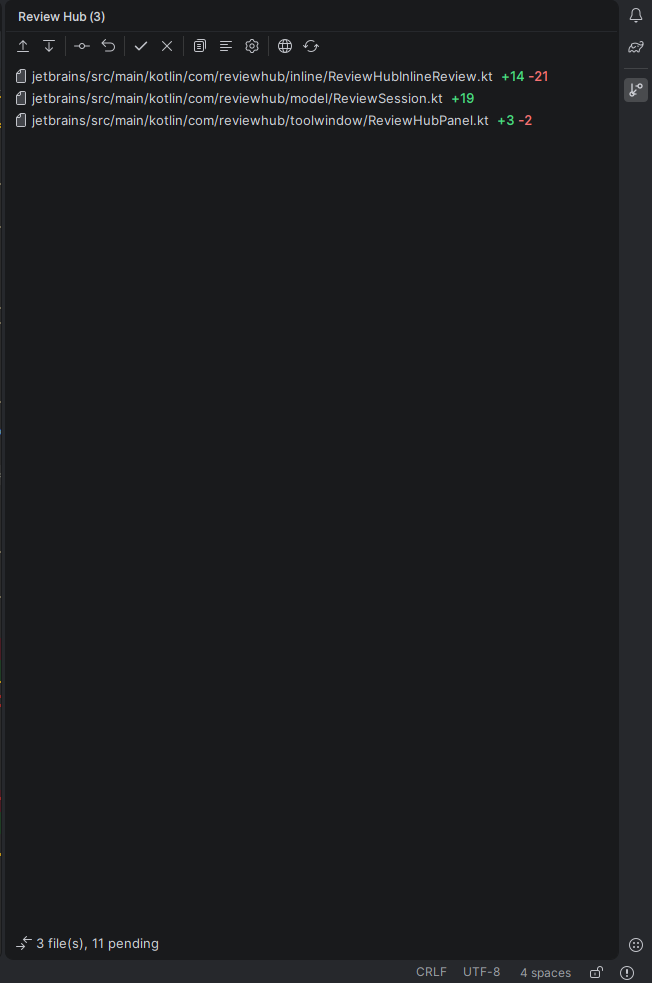
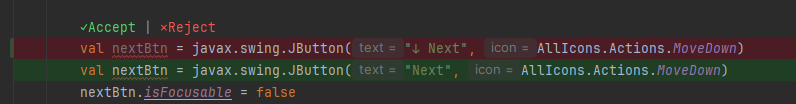

# Review Hub for VS Code

The official Review Hub extension for Visual Studio Code.

## Features
- **Interactive Review Panel**: Side-by-side and unified review tab for all pending agent edits.
- **In-Editor Staged Review**: Accept or reject individual hunks directly via CodeLens, inline diff decorations, and ghost text.

<p align="center">
  
</p>

<p align="center">
  
</p>
- **Copy MCP Configuration**: One-click command `Review Hub: Copy MCP Config for AI Tools` to copy the clean `review-hub-mcp` configuration into your clipboard.
- **Active Workspace Watcher**: Catches direct file writes by background agents even without MCP.

## Building & Packaging
```bash
# From workspace root
npm run build
npm run package:vscode

# Or inside vscode/
npm run package
```
This produces `vscode/review-hub-vscode-<version>.vsix` (~49 KB).
